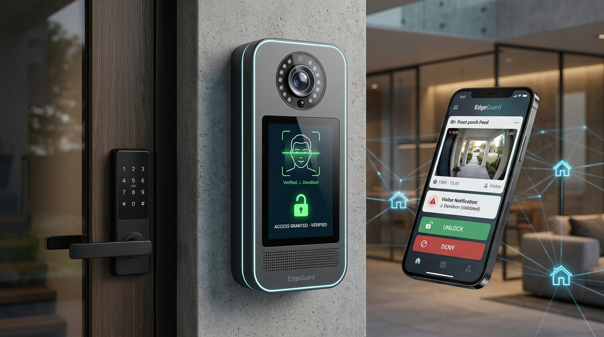

# 🛡️ EdgeGuard: Privacy-Preserving Smart Door Access & Collaborative Threat Telemetry
> **40th International Conference on VLSI Design (VLSID 2027) • Bengaluru, India**  
> **Contest Category**: Student Design Contest  
> **Platform**: Platform 1 — C-DAC Aries v3 Board (THEJAS32 32-bit RISC-V SoC @ 100 MHz, 256 KB SRAM)

---



---

## 📌 Executive Summary

Modern smart doorbells (e.g., Amazon Ring, Google Nest) stream unencrypted biometric video to offshore cloud servers, charge recurring monthly subscriptions, and fail completely during internet blackouts. Conversely, traditional digital keypad locks cannot screen unexpected visitors or protect elderly occupants living alone.

**EdgeGuard** is an indigenous, edge-intelligent access and community safety system powered by India's **C-DAC THEJAS32 32-bit RISC-V SoC (Aries v3 @ 100 MHz)**. The system implements:
1. **Pre-Authorized Resident Entry**: On-chip face credential verification that unlocks a 12V solenoid deadbolt automatically in $<240\text{ ms}$ (no manual effort for elderly residents).
2. **Unrecognized Visitor Screening**: Low-bandwidth photo alerts transmitted to a local mobile app dashboard with remote Open/Deny controls and a time-limited two-way voice intercom.
3. **Collaborative Threat Mesh**: Generates a compact, cryptographically signed 32-byte threat alert vector upon detecting tampering or loitering (>30s), broadcast via an auxiliary ESP32 peer-to-peer wireless mesh to alert neighboring houses without sharing raw video feeds.
4. **Deterministic Resource Fit**: Engineered strictly within a **$\le 165\text{ KB}$ SRAM footprint** ($<65\%$ of 256 KB internal SRAM).

---

## 📂 Repository Contents

| File / Folder | Description |
| :--- | :--- |
| **[`EdgeGuard_VLSID2027_Official_Submission.docx`](EdgeGuard_VLSID2027_Official_Submission.docx)** | Official submission-ready document formatted to the 6 contest template headings with embedded render and tables. |
| **[`EdgeGuard_Full_Fledged_Master_Engineering_Dossier.docx`](EdgeGuard_Full_Fledged_Master_Engineering_Dossier.docx)** | Comprehensive 8-chapter master engineering dossier including circuit diagrams, math calculations, and reviewer defense script. |
| **[`EdgeGuard_Master_Project_Dossier.md`](EdgeGuard_Master_Project_Dossier.md)** | Full project documentation in Markdown for quick reading and web rendering. |
| **[`assets/`](assets/)** | High-resolution 3D industrial design renders and architectural diagrams. |
| **[`scripts/`](scripts/)** | Python automation scripts used to build and format official Word documents. |

---

## 🏗️ System Architecture

```
+----------------------------------------------------------------------------------------------------+
|                                    EDGEGUARD SYSTEM ARCHITECTURE                                   |
+----------------------------------------------------------------------------------------------------+
|                                                                                                    |
|    [ DOORWAY SENSORS & INPUTS ]                                        [ ACTUATORS & HARDWARE ]    |
|    +-----------------------------+                                    +--------------------------+ |
|    | Optical Camera Module (SPI) |---+                            +-->| 12V Solenoid Door Lock   | |
|    +-----------------------------+   |                            |   | (Optocoupled Relay)      | |
|    +-----------------------------+   |                            |   +--------------------------+ |
|    | PIR Motion Sensor (Wakeup)  |---+   +--------------------+   |   +--------------------------+ |
|    +-----------------------------+   |   |   C-DAC ARIES v3   |---+-->| 0.96" OLED Status Screen | |
|    +-----------------------------+   +-->| THEJAS32 (100 MHz) |   |   | (I2C: 'ACCESS GRANTED')  | |
|    | Piezo Shock / Tamper Sensor |---+   | 256 KB Int. SRAM   |   |   +--------------------------+ |
|    +-----------------------------+   |   +--------------------+   |   +--------------------------+ |
|    | Two-Way Audio Mic (I2S)     |---+     |   |            ^     +-->| Speaker / Chime (PWM)    | |
|    +-----------------------------+         |   |            |         +--------------------------+ |
|    | Elderly SOS Panic Button    |---------+   | State &    | Auth                                 |
|    +-----------------------------+             | Threat     | Decision                             |
|                                                v Engine     |                                      |
|    [ MODULAR COMPANION DOMAIN ]            Isolated Packet  |                                      |
|    +-------------------------------------------+ UART Link  |                                      |
|    | ESP32 Companion (Wi-Fi & Mesh Transceiver)|<-----------+                                      |
|    +-------------------------------------------+                                                   |
|             │                               │                                                      |
|             ▼                               ▼                                                      |
|    [ LOCAL MOBILE APP DASHBOARD ]   [ P2P FEDERATED MESH NETWORK ]                                 |
|    • Visitor Photo Alert Card       • Broadcast 32-Byte Threat Alert Vector                        |
|    • Remote OPEN / DENY Controls    • Warns Neighboring Houses Instantly                           |
|    • Timed Two-Way Voice Intercom   • Zero Raw Video or Face Leakage                               |
+----------------------------------------------------------------------------------------------------+
```

---

## ⚙️ Real-World Operational States

```
┌────────────────────────────────┬────────────────────────────────┬────────────────────────────────┐
│    CASE 1: FAMILY MEMBER       │     CASE 2: UNKNOWN VISITOR    │     CASE 3: SUSPICIOUS THREAT  │
├────────────────────────────────┼────────────────────────────────┼────────────────────────────────┤
│ 1. Son/Daughter walks to door. │ 1. Delivery person or stranger │ 1. Intruder loiters (>30 secs) │
│ 2. Camera captures face.       │    rings bell or stands outside│    or physically hits the lock.│
│ 3. Aries v3 checks local       │ 2. Face is NOT recognized in   │ 2. Piezo shock/PIR timer trips.│
│    keyring inside its SRAM.    │    local keyring.              │ 3. Aries v3 generates a signed │
│ 4. MATCH CONFIRMED!            │ 3. Snapshot sent to owner's    │    compact 32-byte threat code.│
│ 5. Relay pulses lock open in   │    phone app over local Wi-Fi. │ 4. ESP32 broadcasts code over  │
│    <240 milliseconds.          │ 4. Owner sees photo & decides: │    peer-to-peer wireless mesh. │
│ 6. Grandparents don't have to  │    • OPEN: Remote door unlock  │ 5. All neighboring doors and   │
│    get up or touch the door.   │    • DENY: Reject access       │    guard cabin sound an alert  │
│                                │    • TALK: 2-way voice intercom│    BEFORE intruder reaches them│
└────────────────────────────────┴────────────────────────────────┴────────────────────────────────┘
```

---

## 🔬 Technical Defense: 256 KB SRAM Budget on THEJAS32

* **SRAM Memory Budget ($\le 165\text{ KB}$ Peak Allocation)**:
  * Grayscale frame buffer ($96 \times 96 \times 1\text{B} \times 2$ double buffers): **$18\text{ KB}$**
  * INT8 Quantized MobileFaceNet-Tiny activation buffers (ping-pong layer reuse): **$135\text{ KB}$**
  * FreeRTOS kernel + resident vector keyring + threat packet buffers: **$12\text{ KB}$**
  * **Headroom Remaining**: $>90\text{ KB}$ ($35.6\%$) safe margin.
* **Compute Cycle Math (@ 100 MHz)**:
  * $\approx 12.8\text{ Million MACs}$ executed on RV32IM hardware integer multiplier (`mul`) taking $\approx 180\text{ ms}$.
  * Cosine distance dot-product takes $<1\text{ ms}$.
  * **Total Unlock Latency**: **$<240\text{ ms}$**.
* **Zero-Overhead Audio Passthrough**:
  * Duplex I2S microphone (INMP441) and speaker amplifier (MAX98357A) connect directly to the ESP32 companion node.
  * Audio streaming bypasses the THEJAS32 core, keeping voice latency **$<120\text{ ms}$** without starving the RISC-V controller.

---

## 🎯 Target Evaluation Benchmarks

| Metric | Target Objective | Verification Methodology |
| :--- | :--- | :--- |
| **Total Unlock Latency** | **$< 240\text{ ms}$** | Digital oscilloscope: PIR interrupt rising edge to relay pin GPIO high pulse |
| **Deep-Sleep Standby Power** | **$< 18\text{ mW}$** (@ 3.3V) | Bench measurement: THEJAS32 clock-gated, ESP32 deep-sleep ($10\,\mu\text{A}$) |
| **Active Unlocking Power** | **$< 420\text{ mW}$** (@ 3.3V) | Peak consumption during 100 MHz inference + OLED + 50ms relay pulse |
| **P2P Mesh Alert Delivery Latency**| **$< 350\text{ ms}$** | End-to-end time for a signed 32-byte packet to hop across 3 consecutive nodes |
| **False Acceptance Rate (FAR)** | **$< 0.1\%$** | Enforced by Cosine Similarity threshold $\ge 0.82$ + optical liveness checks |
| **Peak SRAM Memory Footprint** | **$\le 165\text{ KB}$** ($<65\%$ of 256 KB) | Static `.bss` + `.data` linker analysis combined with FreeRTOS heap telemetry |

---

## 💰 Bill of Materials (BOM) Comparison

* **EdgeGuard**: **~₹2,880 ($35 USD) one-time build cost • ₹0 monthly fees • 100% data private**
* **Amazon Ring / Google Nest**: **₹15,000–₹22,000 purchase • ₹500/month fees • Cloud data risk**
* **Traditional Digital Lock (Godrej/Yale)**: **₹8,000–₹12,000 • Blind lock • No threat sharing**

---

## 📚 References
1. C-DAC, *"VEGA Processors & ARIES v3 Board User Manual and Technical Specifications"*, Centre for Development of Advanced Computing (C-DAC), MeitY, Govt. of India, 2024. [https://vegaprocessors.in]
2. RISC-V International, *"The RISC-V Instruction Set Manual, Volume I: Unprivileged Architecture"*, 2019.
3. S. Chen et al., *"MobileFaceNets: Efficient CNNs for Accurate Real-Time Face Verification on Mobile Devices"*, IEEE ICB, 2018.
4. H. B. McMahan et al., *"Communication-Efficient Learning of Deep Networks from Decentralized Data"*, *AISTATS*, PMLR, 2017.
5. P. Warden and D. Situnayake, *"TinyML: Machine Learning on Microcontrollers"*, O'Reilly Media, 2019.
6. National Institute of Standards and Technology (NIST), *"Lightweight Cryptography Standards for Constrained Devices"*, NIST SP 800-226, 2024.
